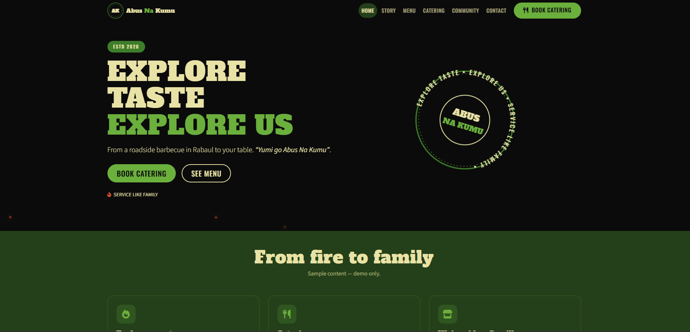
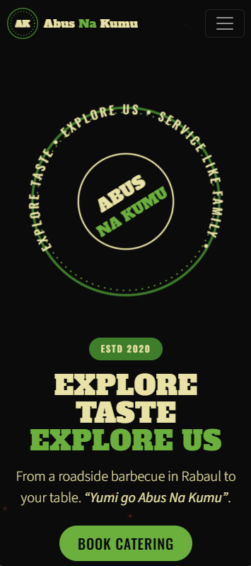

# Abus Na Kumu — Design Concept

An earthy, story-led food and catering site that makes visitors hungry and proud of a PNG-owned brand.

**Status:** Design concept — not the official website. Built by **Tesseract Cloud Technologies, Port Moresby**. Live demo: `https://tesseract-cloud-technologies.github.io/abus-na-kumu/`.





---

## 1. Project overview

Abus Na Kumu is a Tok Pisin name meaning meat and greens. The brand was founded by chef Richard Mark, began in Rabaul, East New Britain, and grew from a roadside barbecue into catering. It is opening its first bar and grill restaurant in Waigani, and also sells merchandise and cooking equipment and supports community projects. Its slogans are EXPLORE TASTE EXPLORE US and SERVICE LIKE FAMILY.

The site serves office administrators booking team lunches, young professionals and foodies exploring the new restaurant, and community partners or sponsors evaluating the brand's values. The concept exists to make a visitor hungry, proud of the story, and ready to book catering within a short session, and to give the owner a reviewable blueprint before any production build.

Everything on this site is **sample content** unless explicitly marked otherwise. No statistics, awards, testimonials, dates, or prices have been invented beyond what was supplied in the brief.

---

## 2. Objectives and goals

**Business goals**
- Increase catering bookings.
- Build awareness of the new Waigani restaurant.
- Strengthen brand loyalty.
- Increase visibility for sponsors and community partners.

**Design goals**
- Tell the founder story in under a minute of scrolling.
- Make menu browsing effortless on a phone.
- Keep the logo's black, green and cream badge look intact across every page.

**Suggested success measures for a live version**
- Home page to catering quote form completion rate.
- Menu page scroll depth and filter use.
- Story page time on page.
- Restaurant awareness clicks (Find us, Contact).
- Community page engagement and sponsor enquiries.

These are suggested measures, not supplied data.

---

## 3. Users and user goals

| Persona | Situation | Goal | How the interface helps |
|---|---|---|---|
| Office administrator | Booking lunch for a team; needs a clear per-head cost and a quick confirmation | Get a quote without a phone call | Catering quote form with live per-head estimate and a success state |
| Young professional or foodie | Curious about the new Waigani bar and grill | See the menu and the story quickly | Story page and menu page; Home page links to both |
| Community partner or sponsor | Evaluating whether the brand shares their values | Understand community initiatives and the founder's story | Community page and story timeline |

**Top three user tasks and target taps/clicks**
1. From home page to catering quote submission — **3 taps** (Catering → fill package and guests → submit).
2. From home page to a filtered menu view — **2 taps** (Menu → tap a category chip).
3. From home page to founder story — **1 tap** (Story).

---

## 4. Brand and visual identity

Brand cues came from the brief: an earthy, Tok Pisin-named food brand with a black, green and cream badge, a slab wordmark, and a founder story rooted in Rabaul. The visual language leans on Charcoal and Olive Deep for depth, with Leaf Green and Cream Gold for warmth.

**Colour palette**

| Swatch | Name | Hex | Role | Contrast note |
|---|---|---|---|---|
|  | Charcoal | #0B0B0B | Page base, hero backdrop | AA against Cream Gold and White |
|  | Forest Green | #3E7D2A | Ribbon banner, badges, accents | AA against Cream Gold |
|  | Leaf Green | #6BAF3D | Buttons, chips, hover states | Use with Charcoal text for AA |
|  | Cream Gold | #E9E2A6 | Primary text on dark, badge fill | AA against Charcoal |
|  | Olive Deep | #24401A | Secondary dark sections | AA against Cream Gold |
|  | Ember | #E4572E | Fire and grill details only | Decorative; not used for body text |

**Typography**

| Font | Weights | Where used | Why |
|---|---|---|---|
| Alfa Slab One | 400 | Display headings, wordmark treatment | Matches the slab lettering of the logo and reads as bold and confident |
| Oswald | 400, 500, 600 | Ribbons, labels, buttons, prices | Condensed sans that keeps calls to action legible and echoes roadside signage |
| Source Sans 3 | 300, 400, 600 | Body text, descriptions, small print | Clean, readable body font that keeps the story and menu comfortable to read on a phone |

**Signature shapes and motifs**
- A dotted-ring circular badge with curved slogan text in SVG.
- A green ribbon banner with folded tails drawn via `clip-path`.
- Fork, knife and spoon icons from Font Awesome Free 6.5.2.
- Kumu-leaf silhouettes used as section dividers.
- A subtle chalkboard grain created with layered CSS gradients.

**Imagery and icons**
No stock photography is used. Food and brand imagery are represented by CSS gradient scenes and inline SVG so the layout can be judged without photos. Image slots are clearly marked and given gradient fallbacks. Icons are chosen for clarity: flame, utensils, store, drumstick, leaf, bowl, seedling, hand-heart, mountain-sun.

**Tone of voice**
Earthy and warm. Plain PNG English. "Yumi go Abus Na Kumu" and "Sharim liklik abus na kumu" are used exactly as supplied, and sample content is labelled as sample wherever it appears.

---

## 5. UI design system

**Grid and spacing**
Bootstrap 5.3.3 twelve-column grid. Section rhythm uses `py-5` with `clamp()` on display type. Cards share a 16px radius and a single soft shadow token.

**Breakpoints**
Mobile-first, tested at 320, 360, 390, 768, 1024, 1440 and 1920px. The region chips and menu filter chips scroll inside their own overflow containers. The sticky bottom bar appears only on phones.

**Key components and states**

| Component | States |
|---|---|
| Primary button (`btn-leaf`) | Default, hover (lift + green shadow), focus-visible, active, disabled |
| Outline button (`btn-outline-cream`) | Default, hover, focus-visible |
| Region chip | Default, hover, active |
| Menu filter chip | Default, hover, active |
| Menu card | Default, hover (3D tilt), focus-visible |
| Package button (catering) | Default, hover, active |
| Quote form input | Default, focus (leaf ring), invalid, valid |
| Ember sparks | Animated (max 12), hidden under reduced motion |

**Animations and reduced-motion fallbacks**

| Animation | Purpose | Reduced-motion fallback |
|---|---|---|
| Slogan ring slow rotation (40s) | Nods to the circular badge without dominating | Disabled — static ring |
| Ribbon unroll (scaleX) | Adds a confident reveal to the banner | Disabled — static ribbon |
| Steam wisps over food cards | Suggests hot, fresh food | Disabled — wisps hidden |
| 3D tilt on menu cards | Makes menu browsing feel tactile | Disabled — no tilt |
| Ember sparks in hero (max 12) | Warm hint of fire and grill | Disabled — sparks not rendered |
| Button lift 2px | Confirms interactivity | Transition duration reduced |

All motion is disabled under `prefers-reduced-motion: reduce`.

**Accessibility decisions**
- Skip link on every page.
- One `<h1>` per page.
- Visible `:focus-visible` ring in Cream Gold.
- ARIA labels on all icon buttons.
- Catering quote form is front-end only and clearly states "This is a demo, no real order has been made."
- Minimum 44px tap targets.
- AA contrast for text; Ember never used for body text.

---

## 6. Page map and user flows

**Sitemap**

```mermaid
flowchart TD
    Home[index.html] --> Story[story.html]
    Home --> Menu[menu.html]
    Home --> Catering[catering.html]
    Home --> Community[community.html]
    Home --> Contact[contact.html]
    Home --> Flavours[PNG in a Million Flavours explorer]
    Menu --> Filters[Menu filter chips]
    Catering --> Quote[Catering quote form]
    Story --> Timeline[Founder timeline]